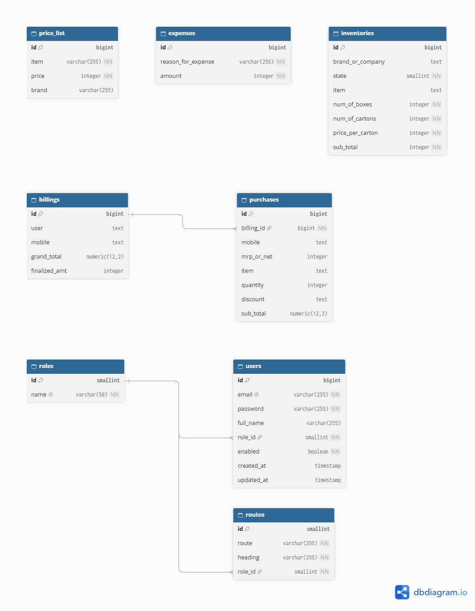

# Vinayaka Traders

Backend REST API for the Vinayaka Traders crackers-retail application. It supports user/admin authentication, product price-list retrieval, bill generation (including a downloadable PDF), expense tracking, and inventory tracking through the `Ordered → Received → Unpacked` workflow.

## Contents

- [Technology stack](#technology-stack)
- [Features](#features)
- [Architecture and project structure](#architecture-and-project-structure)
- [Prerequisites](#prerequisites)
- [Local setup](#local-setup)
- [Configuration and security](#configuration-and-security)
- [Database migrations](#database-migrations)
- [API reference](#api-reference)
- [Database schema](#database-schema)
- [Generated ER diagram with dbdiagram.io](#generated-er-diagram-with-dbdiagramio)
- [Build and test](#build-and-test)

## Technology stack

| Component | Technology |
|---|---|
| Language | Java 21 |
| Framework | Spring Boot 3.5.15 |
| Build | Maven |
| Database | PostgreSQL |
| Persistence | Spring Data JPA / Hibernate |
| Schema versioning | Flyway (`src/main/resources/db/migration`) |
| Authentication | Spring Security, JWT (`java-jwt`), Argon2 password hashing |
| Validation | Jakarta Bean Validation |
| PDF generation | OpenPDF |
| Boilerplate reduction | Lombok |

## Features

- User and administrator registration and login.
- Stateless, bearer-token authentication with role-based authorization.
- Price-list retrieval grouped by brand.
- Bill calculation, persistence of bill header and line items, and PDF download.
- Administrator expense entry and expense-total retrieval.
- Administrator inventory listing, filtering, pagination, and state transitions.
- PostgreSQL schema evolution through ordered Flyway migrations.

## Architecture and project structure

The application follows a conventional layered Spring Boot structure:

```text
src/main/java/com/crackers/vinayakatraders/
├── controller/    # REST endpoints and HTTP response handling
├── service/       # Business rules and transactional operations
├── repository/    # Spring Data persistence interfaces
├── entity/        # JPA entities mapped to PostgreSQL tables
├── dto/           # Request/response records and projections
├── security/      # JWT filter, user details, and security configuration
├── constants/     # Inventory state enum
└── exception/     # Domain-specific exceptions

src/main/resources/
├── application.yaml
├── assets/        # Resources used by PDF generation
└── db/migration/  # Flyway SQL migrations
```

Typical request flow:

```text
HTTP request → Controller → Service → Repository → PostgreSQL
                    ↑          ↓
                 DTOs       business rules
```

## Prerequisites

- JDK 21.
- Maven 3.9+ (or use the Maven Wrapper if the repository contains `mvnw` / `mvnw.cmd`).
- PostgreSQL 14+ (a recent supported PostgreSQL release is recommended).
- Git.

## Local setup

### 1. Clone the repository

```bash
git clone https://github.com/scientist-v08/crackers-java.git
cd crackers-java
```

If you need the branch reviewed for this document:

```bash
git checkout develop
```

### 2. Create the PostgreSQL database

The checked-in `application.yaml` currently points to a local database named `crackersv3` on port `5432` and uses the PostgreSQL user `postgres`.

Create the database (using `psql` or pgAdmin):

```sql
CREATE DATABASE crackersv3;
```

Ensure the database user configured in the application has permission to connect and create/alter tables, sequences, indexes, and constraints.

### 3. Configure the application

Open `src/main/resources/application.yaml` and set the datasource URL, username, password, and JWT secret for your local environment. Do not commit personal credentials or production secrets.

Example local configuration shape:

```yaml
server:
  port: 3201

spring:
  datasource:
    url: jdbc:postgresql://localhost:5432/crackersv3?sslmode=disable
    username: postgres
    password: ${DB_PASSWORD}
    driver-class-name: org.postgresql.Driver

jwt:
  secret: ${JWT_SECRET}
  expiration-ms: 28800000
```

The example uses environment-variable placeholders for secrets. The current checked-in YAML contains literal datasource credentials and a fallback JWT secret; replace those before running outside a disposable local environment. See [Configuration and security](#configuration-and-security).

### 4. Run the application

With Maven installed:

```bash
mvn clean spring-boot:run
```

Or build a jar and run it:

```bash
mvn clean package
java -jar target/vinayakatraders-0.0.1-SNAPSHOT.jar
```

On startup, Spring Boot/Flyway should apply pending SQL migrations from `src/main/resources/db/migration`. The API listens on port `3201` according to the checked-in configuration.

Base URL:

```text
http://localhost:3201
```

## Configuration and security

| Setting | Current checked-in value / behavior |
|---|---|
| HTTP port | `3201` |
| PostgreSQL URL | `jdbc:postgresql://localhost:5432/crackersv3?sslmode=disable` |
| Database user | `postgres` |
| JWT expiry | `28800000` ms (8 hours) |
| Session policy | Stateless |
| Password hashing | Argon2PasswordEncoder |
| CSRF | Disabled (API is stateless) |
| Authorization | Public auth endpoints; `/all/**` requires USER or ADMIN; `/admin/**` requires ADMIN |

Send the JWT returned by the authentication endpoints on protected requests:

```http
Authorization: Bearer <access_token>
```

**Security checklist before deployment**

1. Remove the committed database password and JWT fallback secret; inject secrets through environment variables or a secrets manager.
2. Use a high-entropy, private JWT signing secret and rotate it if it has ever been exposed.
3. Do not expose `/admin/signup` as an unrestricted public administrator-provisioning endpoint in a production deployment. Restrict or disable it after initial provisioning.
4. Review CORS origins and the DEBUG/TRACE logging configuration before production.
5. Use HTTPS and restrict database network access.
6. Use `spring.jpa.hibernate.ddl-auto: validate` (or an equivalent non-mutating production setting) when Flyway owns schema changes. The current YAML says `update`; that is not a good production migration strategy.

## Database migrations

Flyway SQL files are stored under `src/main/resources/db/migration` and are applied in version order. The reviewed branch contains:

| Migration | Purpose |
|---|---|
| `V1__init.sql` | Creates roles, users, routes and initial role/route data. |
| `V2__create_price_list_and_update_routes.sql` | Creates `price_list`, seeds initial product rows, and resets user routes. |
| `V3__update_admin_routes.sql` | Adds administrator navigation routes. |
| `V4__create_expenses.sql` | Creates `expenses`. |
| `V5__improve_seq_and_naming.sql` | Converts role/route identifiers to SMALLINT, renames `routes.role` to `role_id`, and restores foreign keys. |
| `V6__fix_sequence_increment.sql` | Aligns selected sequence increments with JPA allocation size 50. |
| `V7__add_brand_to_price_list.sql` | Adds product brand and recreates the price-list sequence; seeds current price-list data. |
| `V8__expenses_seq_fix.sql` | Creates/aligns the expenses sequence. |
| `V9__new_routes_bill_inventory.sql` | Rebuilds routes and creates `billings` and `purchases`. |
| `V10__create_inventories.sql` | Creates inventory storage, state and quantity constraints, and indexes. |

**Important:** Flyway migrations are versioned and should be treated as immutable once applied to a shared or production database. Add a new migration for subsequent schema changes; do not edit an already-applied migration. The current `application.yaml` also configures Hibernate `ddl-auto: update`; for a Flyway-led schema lifecycle, prefer `validate` after confirming that the existing database and entity mappings are aligned.

## API reference

All paths below are relative to `http://localhost:3201`. Request bodies and responses use JSON unless noted. Protected endpoints require `Authorization: Bearer <access_token>`.

### Authentication

| Method | Endpoint | Access | Description |
|---|---|---|---|
| `POST` | `/signup` | Public | Register a regular user and return a JWT. |
| `POST` | `/admin/signup` | Public in current security config | Register an administrator and return a JWT. Restrict this endpoint before production. |
| `POST` | `/login/user` | Public | Authenticate and return a JWT, navigation routes, and admin flag. |

#### `POST /signup`

Request:

```json
{
  "email": "customer@example.com",
  "password": "at-least-8-characters",
  "fullName": "Customer Name"
}
```

`email` must be a valid, nonblank email. `password` must be 8–100 characters. `fullName` is optional.

Response (`200 OK`):

```json
{
  "token": "<jwt>",
  "type": "Bearer",
  "email": "customer@example.com",
  "roleName": "ROLE_USER"
}
```

#### `POST /admin/signup`

Request shape is the same as regular signup. In this DTO, password length is 8–15 characters. Response shape is `JwtResponse`, with `roleName` equal to `ROLE_ADMIN`.

#### `POST /login/user`

Request:

```json
{
  "email": "customer@example.com",
  "password": "your-password"
}
```

Response shape (`200 OK`):

```json
{
  "access_token": "<jwt>",
  "routes": [
    {
      "id": 1,
      "route": "/billing",
      "heading": "Billing",
      "roleName": "ROLE_USER"
    }
  ],
  "isAdmin": false
}
```

The route list is populated from the user's role-specific rows in `routes` and sorted by route ID. The exact route list depends on the migration data in the database.

### Billing

| Method | Endpoint | Access | Success response |
|---|---|---|---|
| `POST` | `/all/billing/preview` | USER or ADMIN | `201 Created`, PDF bytes (`application/pdf`) as an attachment |

#### `POST /all/billing/preview`

Request:

```json
{
  "user": "Customer Name",
  "mobile": "9876543210",
  "grandTotal": 1200,
  "billItems": [
    {
      "slNo": 1,
      "item": "Example cracker",
      "mrpOrNet": 100,
      "quantity": 2,
      "discount": "10%",
      "subTotal": 180
    }
  ],
  "discount": "10%",
  "finalizedAmt": 180
}
```

- `user` and `mobile` are required; mobile must contain exactly 10 digits.
- `billItems` must contain at least one item.
- Each item requires a positive `slNo`, nonblank `item`, nonnegative `mrpOrNet`, and positive `quantity`.
- `discount` is required. The service accepts a numeric value with or without `%`; values `>= 1` are interpreted as percentages, while values below `1` are treated as multipliers.
- The service calculates subtotals and grand total from the line items. `grandTotal` and each line's `subTotal` are present in the request DTO but the service does not rely on them for its calculation.
- For item names beginning with `Other`, the line calculation skips the overall discount multiplier.
- If `finalizedAmt` is supplied and positive, it must not be below the service's 90%-of-calculated-grand-total threshold.
- The service persists one `billings` row and its `purchases` rows in a transaction, then returns the PDF attachment. The stored `finalized_amt` is the supplied positive `finalizedAmt`, otherwise it falls back to the request `grandTotal` (which is distinct from the recomputed grand total). The PDF uses the `Vinayaka Traders` heading and expects `assets/ganesha.png` on the classpath.

Response headers include `Content-Type: application/pdf` and `Content-Disposition: attachment; filename=...`.

### Price list

| Method | Endpoint | Access | Success response |
|---|---|---|---|
| `GET` | `/all/price-list` | USER or ADMIN | `200 OK`, JSON array grouped by brand |

Example response shape:

```json
[
  {
    "brand": "Standard",
    "list": [
      {
        "id": 1,
        "item": "Example product",
        "price": 100,
        "brand": "Standard"
      }
    ]
  }
]
```

The controller returns `List<ProductsList>`. Each group contains `brand` and a `list` of product entries. Product data comes from `price_list`.

### Expenses (administrator only)

| Method | Endpoint | Access | Success response |
|---|---|---|---|
| `POST` | `/admin/expenses` | ADMIN | `200 OK`, `{"success":"Expense added"}` |
| `GET` | `/admin/expenses` | ADMIN | `200 OK`, expenses array and total |

#### `POST /admin/expenses`

Request:

```json
{
  "reasonForExpense": "Transport",
  "amount": 250
}
```

`reasonForExpense` must be nonblank. `amount` must be at least 10.

Response:

```json
{
  "success": "Expense added"
}
```

#### `GET /admin/expenses`

Response shape:

```json
{
  "expenses": [
    {
      "id": 1,
      "reasonForExpense": "Transport",
      "amount": 250
    }
  ],
  "total": 250
}
```

`total` is calculated by summing the returned expense amounts.

### Inventory (administrator only)

| Method | Endpoint | Access | Description |
|---|---|---|---|
| `GET` | `/admin/inventory` | ADMIN | List inventory with pagination, item-title filtering and optional state filtering. |
| `POST` | `/admin/inventory` | ADMIN | Add an inventory record. |
| `POST` | `/admin/updateInventory` | ADMIN | Advance inventory state and optionally split a partial quantity into a new record. |

#### `GET /admin/inventory`

Query parameters:

| Parameter | Default | Constraints / meaning |
|---|---:|---|
| `pageNumber` | `1` | 1-based page number; minimum 1. |
| `pageSize` | `10` | 1–100. |
| `title` | empty | Item-title filter. |
| `state` | omitted | Optional state: `Ordered`, `Received`, or `Unpacked`. |
| `sortBy` | `id` | Accepted by the controller signature but currently not passed to the service. |
| `order` | `desc` | Accepted by the controller signature but currently not passed to the service. |

Example:

```http
GET /admin/inventory?pageNumber=1&pageSize=10&title=rocket&state=Ordered
```

Response shape:

```json
{
  "inventoryItems": [
    {
      "id": 1,
      "brandOrCompany": "Example Brand",
      "state": "Ordered",
      "item": "Rocket",
      "numOfBoxes": 2,
      "numOfCartons": 5,
      "pricePerCarton": 1000,
      "subTotal": 5000
    }
  ],
  "total": 5000,
  "totalElements": 1
}
```

`total` is the filtered sum of inventory subtotals; `totalElements` is the number of matching rows.

#### `POST /admin/inventory`

Request:

```json
{
  "brandOrCompany": "Example Brand",
  "state": "Ordered",
  "item": "Rocket",
  "numOfBoxes": 2,
  "numOfCartons": 5,
  "pricePerCarton": 1000,
  "subtotal": 5000
}
```

The state must be `Ordered`, `Received`, or `Unpacked` (case-insensitive). Box/carton counts and price per carton must be positive. The submitted `subtotal` is retained for API compatibility; the service calculates and persists `pricePerCarton × numOfCartons` itself.

Success response:

```json
{"Success":"Item saved to inventory"}
```

#### `POST /admin/updateInventory`

Request:

```json
{
  "id": 1,
  "brandOrCompany": "Example Brand",
  "item": "Rocket",
  "numOfBoxes": 2,
  "numOfCartons": 3,
  "pricePerCarton": 1000,
  "state": "Received"
}
```

The service looks up the record by `id`. Current state must be `Ordered` or `Received`; it advances `Ordered → Received` and `Received → Unpacked`. If the requested carton quantity equals the existing quantity, the record is updated in place. Otherwise the existing row retains the remaining quantity and a new row is created for the transitioned quantity. The current service uses the existing row's state to determine the next state; the request's `state` field is not used for that decision.

Success response:

```json
{"message":"Inventory updated successfully"}
```

## Database schema

The following tables are represented by the JPA entities and/or Flyway migrations:

| Table | Purpose | Key columns |
|---|---|---|
| `roles` | Application roles | `id` SMALLINT PK, `name` unique |
| `users` | Login identities | `id` BIGINT PK, `email` unique, `password`, `full_name`, `role_id` FK, `enabled`, timestamps |
| `routes` | Role-specific frontend navigation | `id` SMALLINT PK, `route`, `heading`, `role_id` FK |
| `price_list` | Product catalogue and selling prices | `id` BIGINT PK, `item`, `price`, `brand` |
| `expenses` | Business expenses | `id` BIGINT PK, `reason_for_expense`, `amount` |
| `billings` | Bill/customer header | `id` BIGINT PK, `user`, `mobile`, `grand_total`, `finalized_amt` |
| `purchases` | Line items belonging to a bill | `id` BIGINT PK, `billing_id` FK, `mobile`, `mrp_or_net`, `item`, `quantity`, `discount`, `sub_total` |
| `inventories` | Stock records and workflow state | `id` BIGINT PK, `brand_or_company`, `state`, `item`, box/carton quantities, price and subtotal |

### Relationships

- One `roles` row can be referenced by many `users` rows (`users.role_id → roles.id`).
- One `roles` row can be referenced by many `routes` rows (`routes.role_id → roles.id`).
- One `billings` row has many `purchases` rows (`purchases.billing_id → billings.id`).
- `price_list`, `expenses`, and `inventories` are standalone tables in the current schema.
- Billing customer name and mobile are stored as values on `billings`; there is no foreign key from a bill to `users`.
- Inventory records do not currently reference a product, supplier, or purchase table through a foreign key.

### Inventory state encoding

`InventoryState` is persisted with `@Enumerated(EnumType.ORDINAL)`. The ordinal values are:

| Enum ordinal | Java enum | API value | Database constraint |
|---:|---|---|---|
| 0 | `RESERVED` | Not accepted by API | Not allowed by V10 check constraint |
| 1 | `ORDERED` | `Ordered` | Allowed |
| 2 | `RECEIVED` | `Received` | Allowed |
| 3 | `UNPACKED` | `Unpacked` | Allowed |

**Do not reorder or insert enum constants.** Changing their order changes the numeric values persisted in PostgreSQL and can corrupt the interpretation of existing rows. Prefer a string-backed enum or explicit stable database codes in a future migration if you want to make the mapping more resilient.

## Generated ER diagram with dbdiagram.io



## Build and test

Run the test suite:

```bash
mvn test
```

Build the application:

```bash
mvn clean package
```

Run the packaged application:

```bash
java -jar target/vinayakatraders-0.0.1-SNAPSHOT.jar
```

Use Postman, Bruno, IntelliJ HTTP Client, or `curl` to exercise the endpoints. Authenticate first, copy the returned token, and include it as a bearer token for protected APIs.
